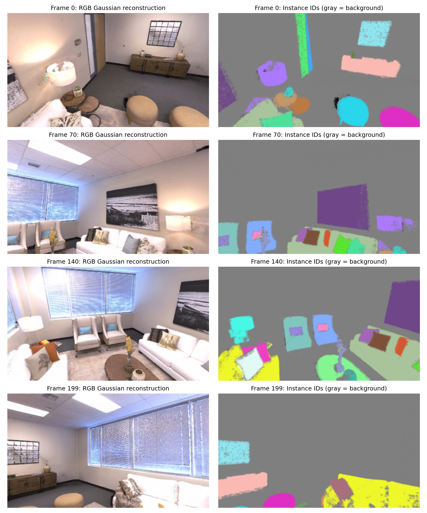
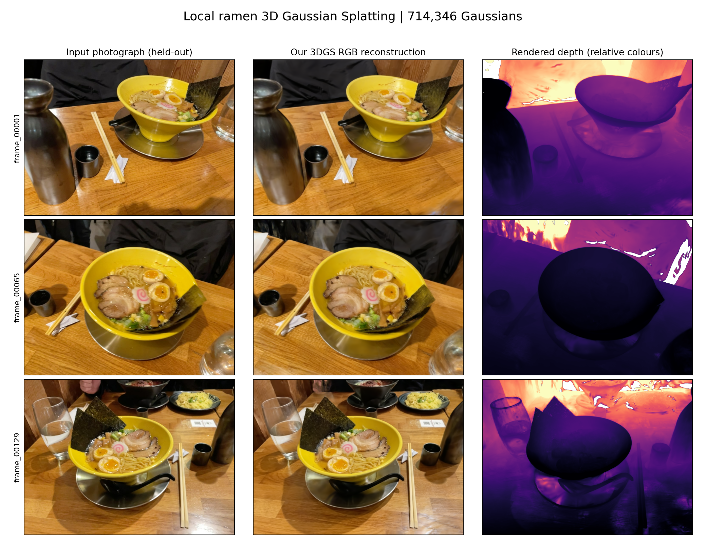

# 3D Gaussian Splatting — reproduction and experiment portfolio

Three project snapshots, local experiment reports, metrics and visualization galleries. This is a research learning archive, not a claim of reproducing all published results. Upstream authorship and local work are distinguished below.

| Folder | Contents | Evidence |
|---|---|---|
| [Dynamic-GSG](Dynamic-GSG/PORTFOLIO.md) | Local Replica mapping, instance/scene graphs, hierarchy queries, feature-loss ablations | 200-frame room0 run; six paired ablation runs across three scenes |
| [gaussiangraph](gaussiangraph/PORTFOLIO.md) | Ramen reconstruction, open-vocabulary segmentation baselines, Control-Follow diagnostics | Reconstruction gallery, 71-query comparison, metrics and ablation reports |
| [gaussian-splatting](gaussian-splatting/PORTFOLIO.md) | Original Graphdeco training/render/evaluation source snapshot | Upstream code; no standalone local training output was verified in this directory |

## Start with the actual results

### Dynamic-GSG: reconstruction and instance map

[Local reproduction notes](Dynamic-GSG/LOCAL_REPRODUCTION.md) · [Feature ablation](Dynamic-GSG/FEATURE_ABLATION.md) · [Hierarchy graph](Dynamic-GSG/results/room0_local200/scene_graph_hierarchy_model.png)

### GaussianGraph: local 3DGS reconstruction

[Experiment briefing](gaussiangraph/SENIOR_BRIEFING.md) · [Segmentation preview](gaussiangraph/results/experiments/segmentation_gallery/preview.png) · [All 71 queries (PDF)](gaussiangraph/results/experiments/segmentation_gallery/all_queries.pdf) · [Comparison metrics](gaussiangraph/results/experiments/TABLE1_RAMEN_COMMON.json)

## What is and is not archived

Included: source snapshots, local patches, dependency versions, configurations, logs, metrics, graph JSON/SVG files, summary images and complete query comparison PDF. Per-frame repetitive masks/renders, intermediate arrays, checkpoints, PLY maps, downloaded models/datasets, environments and build caches remain local.

[ARTIFACT_INVENTORY.csv](ARTIFACT_INVENTORY.csv) records every inspected experiment/output file, its byte size, original location and inclusion decision. [ARCHIVE_SUMMARY.json](ARCHIVE_SUMMARY.json) gives totals. This is an index, not an off-machine backup of excluded weights. Source locations refer to the original workstation; original files were not moved or deleted.

These projects require different CUDA/PyTorch environments. Follow each local reproduction document and `DEPENDENCIES.json` / `UPSTREAM.json`; restore downloaded dependencies separately. Paths inside original scripts/configuration snapshots may need changing. This upload does not rerun training or certify clean-machine reproduction.

Original upstream README files, license files where present, authorship, commits and local patches are preserved. Paper illustrations and upstream benchmark claims are not presented as personal experiment results. One embedded API-key assignment in the publication copy was replaced with an environment-variable lookup; credentials must be supplied locally.
